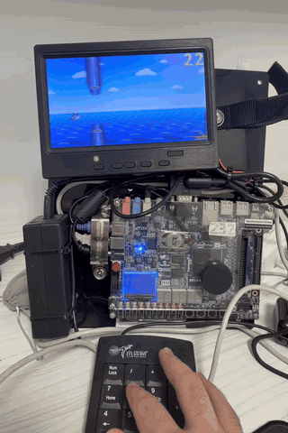
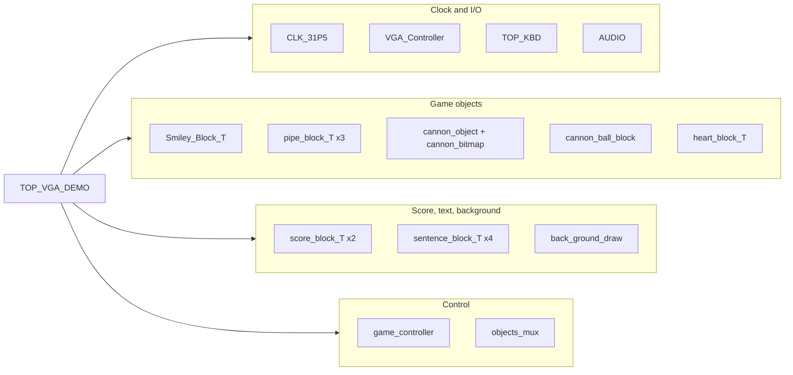
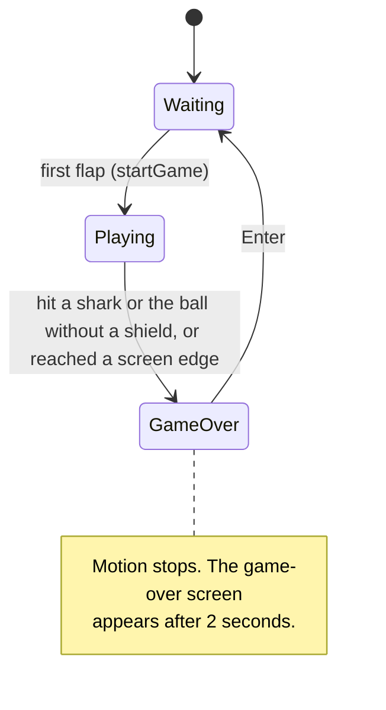

# Pirate Bird

A Flappy Bird-style game in SystemVerilog for an Intel Cyclone V FPGA (Terasic DE10-Standard), with 640x480 VGA output, PS/2 keyboard input and sound.

<!-- TODO: add the gameplay GIF at docs/gameplay.gif -->


Demo video: TODO (add link)

## Highlights

- Renders without a frame buffer: every object is computed per pixel as the screen is drawn.
- Pixel-exact collision detection that follows the sprites' transparency.
- Fixed-point motion, random obstacle respawns and a difficulty ramp.
- Runs at 31.5 MHz with timing met (Fmax 47 MHz), using 5% of the FPGA's logic.

ECE Lab final project, Technion, 2026.

## Features

- A pirate bird flaps over a scrolling sea. Each key press sets an upward speed and gravity pulls the bird back down. The bird's sprite tilts up while it rises and down while it falls.
- Three shark obstacles move right to left. Each has a top part and a bottom part with a gap between them. Passing a shark scores one point, and touching a shark or the top or bottom of the screen ends the game.
- The gap size, the gap height and the distance to the previous shark are chosen at random each time a shark comes back on the right.
- Every 8 sharks passed, the sharks speed up (up to a maximum speed) and a cannon on a boat in the bottom-right corner fires a cannon ball. The ball flies in loops toward where the bird was when it fired, and hitting it ends the game. The cannon sprite shows one of four barrel angles, depending on the bird's height.
- Every 6 sharks passed, the bird gets a shield, shown as a golden heart in the top-left corner. The next hit cracks the heart instead of ending the game, and the bird stays protected for 3 more seconds.
- After 25 sharks, boss mode turns on: the sharks also move up and down toward the bird's height.
- The two-digit score is shown in the top-right corner while playing. Two seconds after a game over, a game-over screen shows the score, the best score since the last reset, and "PRESS ENTER TO RESTART".
- Sound effects: a flap sound, a cannon sound and a game-over jingle.
- Two switches: cheat mode (collisions and the screen edges are ignored, and the keypad + and - keys change the shark speed) and reverse gravity.

## Hardware and tools

| | |
|---|---|
| Board | Terasic DE10-Standard |
| FPGA | Intel Cyclone V SX, 5CSXFC6D6F31C6 |
| Tools | Intel Quartus Prime 17.0.0 Lite Edition |
| Language | SystemVerilog, with Quartus block diagrams (.bdf) for the top level and sub-blocks |
| Peripherals | VGA monitor, PS/2 keyboard, speakers or headphones on the board's line-out jack |

## Architecture

The top level is the schematic `RTL/VGA/TOP_VGA_DEMO.bdf`. The game logic runs on a 31.5 MHz clock from a PLL.



The sub-modules of each block are listed in the table below.

| Module | Role |
|---|---|
| `CLK_31P5` | PLL that turns the 50 MHz board clock into the 31.5 MHz pixel clock. |
| `VGA_Controller` | Generates the VGA sync signals and the current `PixelX`/`PixelY`, and outputs one pulse per frame (`startOfFrame`). Expands the 8-bit color to the board's 24-bit VGA DAC. |
| `TOP_KBD` | PS/2 keyboard interface (`KBDINTF`) and a decoder (`keyPad_decoder`) for keypad 8, +, - and Enter. |
| `Smiley_Block_T` | The bird. `smiley_move` is the motion state machine (gravity, flap, screen limits). `square_object` checks whether the current pixel is inside the bird, after rotating the coordinates for the tilt. `smileyBitMap` reads the sprite ROM. |
| `pipe_block_T` (x3) | One shark each. `pipe_move` handles movement, speed-ups, boss mode, random respawn and scoring. `pipe_object` draws the top and bottom parts. `PipeBitMap` reads the sprite ROM. |
| `cannon_object`, `cannon_bitmap` | The fixed 64x64 boat cannon. The bitmap picks one of 4 frames from the bird's height and passes that frame number on as the barrel angle. |
| `cannon_ball_block` | The cannon ball. `ball_move` moves the center in a straight line toward the bird. `circle_object` adds the loops using a sine/cosine ROM. `ball_object` and `ball_bitmap` draw the 16x16 ball. |
| `heart_block_T` | The shield icon. A state machine steps through 4 heart frames (golden, cracked, cracked with an X, vanishing). |
| `score_block_T` (x2) | Two digits each, for the current score and the best score. Uses a 1-bit digit font drawn at 2x scale, moves to the center on the game-over screen, and hides the tens digit while it is zero. |
| `sentence_block_T` (x4) | The game-over text. `letter_object` finds the character under the pixel, and `LettersBitMap` reads an 8x8 1-bit font. |
| `back_ground_draw` | The scrolling sea background, the game-over image, and the 2-second delay before the game-over screen. |
| `game_controller` | Game rules: collisions, score and best score, the 8/6/25 pass counters, the shield timer, game over and restart. |
| `objects_mux` | Picks the color of each pixel from the drawing requests by fixed priority. |
| `AUDIO` | Plays the flap, cannon and game-over sounds through the board's audio codec. |

## How it works

### VGA timing

`VGA_Controller` counts pixels and lines at 31.5 MHz. A line has 24 front porch, 40 sync, 128 back porch and 640 active pixels. A frame has 9 front porch, 3 sync, 28 back porch and 480 active lines. That gives about 72 frames per second. The sync pulses are active low. `startOfFrame` is a one-clock pulse at the start of vertical sync, and every motion module waits for it before updating its position, so each object moves once per frame.

There is no frame buffer. For every pixel, each object checks whether it covers the current `PixelX`/`PixelY` and, if so, raises a drawing request with a color. `objects_mux` registers the winning color, in this order: score digits, game-over text, game-over image, cannon ball, cannon, heart, bird, sharks 1 to 3, and the sea background when nothing else is drawn.

Colors are 8-bit RGB332 values. The VGA controller widens each field to 8 bits by repeating its most significant bit.

### Pixel coordinates to ROM addresses

Each sprite is a `.mif` file loaded into an `lpm_rom` (8 bits per pixel; the fonts use 1 bit per pixel). An object module subtracts its top-left corner from the pixel position to get `offsetX`/`offsetY`, and the bitmap module turns that offset into an address:

| ROM | Size | Address |
|---|---|---|
| `pirate_bird.mif` | 64x32 | `offsetY * 64 + offsetX` |
| `shark_obstacle.mif` | 64x80 | `offsetY * 64 + offsetX`. `offsetY` stops at 70, so row 70 repeats and the shark's body stretches to any length. The top part uses mirrored offsets, so the same sprite points down into the gap. |
| `boat_cannon.mif` | 4 frames of 64x64 | `{frame, offsetY[5:0], offsetX[5:0]}`, where `frame = ~bird_TLY[8:7]` |
| `hearts.mif` | 4 frames of 32x32 | `{vers, offsetY[4:0], offsetX[4:0]}` |
| `cannonball.mif` | 16x16 | `{offsetY[3:0], offsetX[3:0]}` |
| `sea_bg.mif` | 256x480 | `{pixelY[8:0], pixelX[7:0] + scrollX}` |
| `gameover_bg.mif` | 320x240 | `(pixelY >> 1) * 320 + (pixelX >> 1)`, which draws the image at 2x scale |
| `numbers.mif` | 1-bit, 16x32 per digit | `digit * 512 + (offsetY >> 1) * 16 + (offsetX >> 1)`, 2x scale |
| `font_letters_8x8.mif` | 1-bit, 8x8 per character | `code * 64 + (offsetY >> SCALE) * 8 + offsetX[SCALE +: 3]` |
| `trig_lut.mif` | 128 x 22-bit | Angle 0 to 90 degrees. Each word holds `1024*sin` and `1024*cos`. |

The bird's tilt is done on the coordinates, not in the ROM. When `is_bird` is set, `square_object` multiplies the pixel offset by the matrix `[7 -4; 4 7] / 8`, a rotation of about 30 degrees. The sign of the rotation follows the bird's vertical speed.

The ROM addresses are registered, so the color comes out one clock after the address. Some bitmap modules delay their "inside" flag by one clock so the flag and the color belong to the same pixel.

### Transparency

The color `8'hFF` means transparent. A bitmap module raises its drawing request only when the pixel it reads is not `8'hFF`. So an object's drawn shape, and its collision shape, is the sprite itself, not its bounding rectangle.

### Scrolling

The sea image is 256 pixels wide. `back_ground_draw` adds `scrollX` to `pixelX[7:0]` in 8 bits, so the sum wraps at 256 and the image repeats across the 640-pixel screen with no seam. `scrollX` increases by 3 each frame while the game is running. The background speed is constant.

The sharks are what speed up. Positions and speeds are fixed point (x64). A shark starts at -160/64 = -2.5 pixels per frame. On each speed-up pulse from `game_controller` (every 8 sharks passed), `pipe_move` makes it 40/64 pixels per frame faster, up to 340/64 (about 5.3 pixels per frame). When a shark goes past x = -100, it comes back 270 to 600 pixels (chosen at random) behind the shark in front of it, but never at less than x = 645, so it always reappears off-screen. It also gets a new gap height. The three sharks form a ring, each one following the next.

The random values come from counters that run at 31.5 MHz between a minimum and a maximum, and are sampled on an event. The gap size (100 to 200 pixels) is sampled when the flap key is pressed. The gap height and the spacing are sampled when a shark leaves the screen.

### Game states

The game state is held by flags in `game_controller` (`isGameOver`, `score_ability_flag`, `collision_flag`). The bird, shark and cannon ball each have their own state machine that follows those flags.



- **Waiting:** the bird is at its start position (`smiley_move` in `IDLE_ST`) and the sharks wait off-screen (`pipe_move` in `IDLE_ST`). The first flap sends `startGame` to the sharks.
- **Playing:** each frame, `smiley_move` goes `MOVE_ST` -> `POSITION_CHANGE_ST` (add speed to position, add gravity to speed) -> `POSITION_LIMITS_ST` (clamp to the screen, report an edge hit). `pipe_move` goes `MOVE_ST` -> `POSITION_CHANGE_ST` -> `BOUNDS_CHECK` (respawn and scoring).
- **Game over:** all motion state machines move to `GAME_OVER` (the ball returns to idle). The best score is updated in the same clock if the new score is higher. Enter clears the score, counters, shield and boss flag, and keeps the best score.

The shield is a second set of states: off, then on after 6 sharks passed, then a 3-second grace period after a hit, then off again. The heart icon's state machine steps through its frames once per second during the grace period.

### Collision detection

Collisions are pixel-exact and are found while the frame is drawn. In the same clock, `game_controller` ANDs the bird's drawing request with the OR of the three sharks' requests, and with the cannon ball's request. Because transparent pixels never raise a request, only visible pixels can collide. A collision ends the game unless cheat mode or the shield is on. A hit while the shield is on sets `collision_flag` and starts the 3-second grace timer instead.

Screen edges are checked separately in `smiley_move`. If the bird goes above y = 2 or below the bottom limit, its position is clamped. Without a shield or cheat mode, it also raises `borders_reach`, which ends the game.

A shark scores once per pass: `pipe_move` sends a one-clock pulse the first time the bird's x is past the shark's right edge, and clears that state when the shark respawns. The score is kept as two BCD digits.

## Resource usage

From the Quartus 17.0 fit and timing reports (fitter effort set to Fast Fit):

| Resource | Used | Available | % |
|---|---|---|---|
| Logic (ALMs) | 2,123 | 41,910 | 5% |
| Registers | 1,558 | | |
| Block memory bits | 1,947,392 | 5,662,720 | 34% |
| RAM blocks (M10K) | 253 | 553 | 46% |
| DSP blocks | 26 | 112 | 23% |
| PLLs | 1 | 15 | 7% |
| Pins | 42 | 499 | 8% |

| Clock | Required | Fmax (Slow 1100mV 85C model) |
|---|---|---|
| Pixel clock (PLL output) | 31.5 MHz | 47.24 MHz |

Most of the memory is the two background images. `sea_bg.mif` (122,880 x 8 bits) and `gameover_bg.mif` (76,800 x 8 bits) make up 1,597,440 bits. Full compilation took 2 minutes 13 seconds.

## Build and run

1. Install Quartus Prime 17.0 Lite with Cyclone V device support.
2. Open `Lab1Demo.qpf`.
3. Run **Processing > Start Compilation**. The `.qsf` still lists some SignalTap (`*.stp`) and programming chain (`output_files/*.cdf`) files that are not in this repository. Quartus warns about them, and the build is not affected.
4. Connect the board over USB-Blaster. Open **Tools > Programmer**, add `output_files/Lab1Demo.sof` and click **Start**. A prebuilt `.sof` is attached to the GitHub Release.
5. Connect a VGA monitor, a PS/2 keyboard, and speakers or headphones to the line-out jack.

### Controls

| Input | Action |
|---|---|
| Keypad 8 (PS/2) | Flap. The first press starts the round. |
| Keypad Enter (PS/2) | Start a new round after game over |
| Keypad + / - (PS/2) | Make the sharks faster / slower (cheat mode only) |
| KEY0 | Reset (also clears the best score) |
| KEY3 | Lower the volume one step. After mute it wraps back to full volume. |
| SW0 | Cheat mode: shark, ball and edge collisions are ignored |
| SW1 | Reverse gravity: the bird falls up and flaps down |

## Repository structure

```
.
├── Lab1Demo.qpf, Lab1Demo.qsf    Quartus project and settings
├── DE10_Standard_Audio.sdc       Timing constraints
├── constraints/pin.tcl           Pin assignment script
├── CLK_31P5.*, CLK_31P5/         31.5 MHz PLL (Quartus IP)
├── CLK_31P5_sim/                 PLL simulation model (referenced by CLK_31P5.sip)
├── KBDINTF.qxp                   PS/2 keyboard interface netlist
├── audio_codec_controller.QXP    Audio codec controller netlist
├── *.bdf                         Block diagrams: score, heart, cannon ball, 7-segment
├── *.bsf                         Block symbols for the schematics
└── RTL/
    ├── VGA/                      Top level (TOP_VGA_DEMO.bdf), VGA controller,
    │                             game objects, game controller, mux
    ├── KEYBOARDX/                Keyboard block, key decoder, random generator
    ├── AUDIO/                    Audio block and sounds.mif
    ├── Seg7/                     7-segment decoder (not used by the top level)
    ├── random_new.sv             Random generator with min/max inputs
    ├── sentence_block_T.bdf      Text block
    └── *.mif                     Sprite, background, font and sine/cosine ROMs
```

## Credits

Ameer Assi. Lab partner: Mohammad Yatim. ECE Lab, Technion, 2026.

Course-provided files (ECE Lab, Technion), used unmodified:

- `RTL/VGA/VGA_Controller.sv`
- The audio block: `RTL/AUDIO/` (all files) and `audio_codec_controller.QXP`

`CLK_31P5` was generated with the Quartus IP Catalog (Altera PLL). Some of our source files began from lab template files and keep their original header comments.
